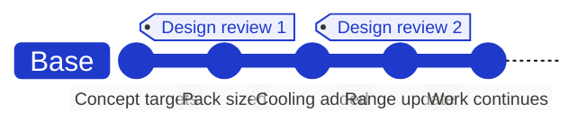
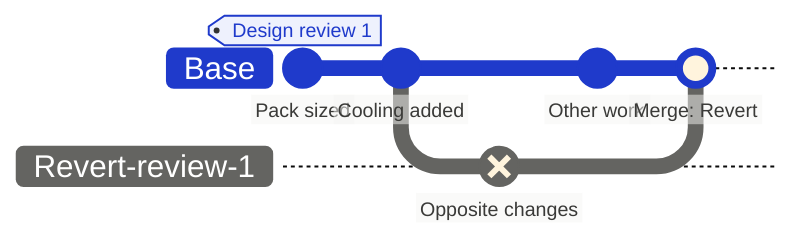

import { VisualPlaceholder } from "/snippets/visual-placeholder.jsx";

A baseline marks a state worth coming back to, such as the design as presented at a milestone review. Work continues past it. Creating a baseline does not change any data, approve anything, or merge a branch.

## Create a baseline

<VisualPlaceholder kind="Screenshot" title="Change history and baselines">
  Change history opened from the clock control on Truck: a named baseline ("Design review 1") in the timeline, the Create baseline button, and the Revert control on the baseline.
</VisualPlaceholder>

1. Switch to the branch you want to capture.
2. Open **Change history** with the clock control.
3. Choose **Create baseline**, enter a name for the milestone, and select **Create**.

Flow opens a comparison of what the new baseline contains. **Overview** shows who created it and when.

Viewers and external users cannot create baselines. If an editor group restricts the branch or its parent, only members can create one.

A baseline copies nothing. It marks a point in the branch's history, so it costs nothing to create one at every milestone.

## Compare against a baseline

Select a baseline in **Change history** to open it. To see what happened since, compare it with **Current**; to inspect an interval, compare two baselines. See [Comparing branches](/branching/comparing-branches).

Every merge also adds a `Merge: <branch>` entry to the history, carrying the review and merge context, so merges work like baselines. Admins can rename entries with **Rename merge**; renames appear in the [audit log](/administration/audit-log).

## Revert a baseline

1. In **Change history**, choose the revert control on the baseline.
2. Confirm **Create revert branch**.
3. Flow creates a branch named `Revert: <baseline>` from the branch the baseline belongs to, fills it with the reverse of the baseline's changes, and opens its review.

Nothing changes until that branch is merged. The original changes stay in history beside the revert, so you can always see what was undone and by whom. Before you merge it, check the result: changes to formulas are not reverted, and a reverted field returns to its earlier value even if someone has edited it since.
