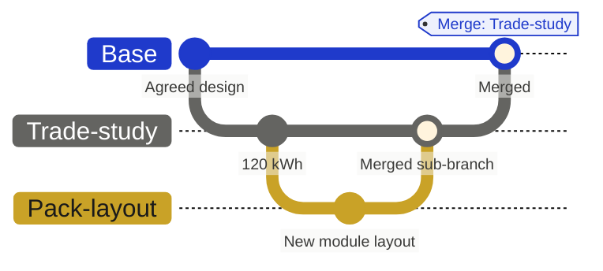
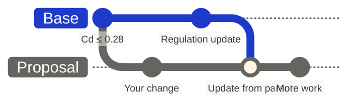
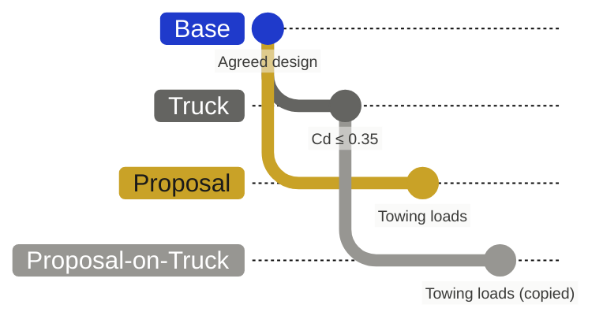

import { VisualPlaceholder } from "/snippets/visual-placeholder.jsx";

A branch gives a change its own working state. The parent stays as it is until the branch merges. Keep everything one change needs in the same branch: the items it edits, the relationships it adds, and the evidence that goes with them. [Branching](/core-concepts/branching) explains why Flow works this way.

## Create a branch

<VisualPlaceholder kind="Screenshot" title="New branch dialog">
  New branch dialog with a name typed in and the Parent Branch dropdown open, listing Base, Coupe, Truck, and SUV. Inset: a branch's actions menu with Create a sub branch highlighted.
</VisualPlaceholder>

1. Open the branch selector and choose **New Branch**. To start from an existing branch, open its actions menu and choose **Create a sub branch**.
2. In the **New branch** dialog, enter a name that says what the work is.
3. Check **Parent Branch**. Choose Base for the shared project state, or another branch when your work depends on it.
4. Create the branch, then confirm its name in the branch selector before you edit.

Creating a branch copies nothing. The branch starts from its parent's state at that moment, and from then on records only its own changes, each with who made it, or which agent, and when. Flow records who created the branch.

A sub-branch starts from another branch and merges back into it, so you can try an idea on top of a proposal without touching the proposal itself:

Viewers cannot create branches, and editor groups can limit who edits a branch. See [Managing branches](/branching/managing-branches).

## Update from the parent

The parent keeps moving while you work. Updating brings that newer work into your branch.

<VisualPlaceholder kind="Screenshot" title="Update from parent with a conflict">
  Update from parent on a proposal branch: incoming changes listed, one conflict on a target value with Keep parent and Keep current, and the Keep parent changes / Keep current changes buttons at the top.
</VisualPlaceholder>

1. Open the branch's actions menu and choose **Update from parent...**.
2. Inspect the incoming changes.
3. For each conflict, choose **Keep parent** or **Keep current**. **Keep parent changes** and **Keep current changes** settle every conflict at once. If AI is enabled, **Suggest resolutions** proposes a choice for each unresolved conflict, with a reason, which you can change.
4. Select **Update from parent**, then check the affected items.

A conflict is the same information changed in incompatible ways on both sides, such as a field edited differently or an item deleted on one side and edited on the other.

Updating changes only your branch. Your own changes keep their authors and times. Where you choose **Keep parent**, the parent's value is written to your branch as a change by you, so the choice is in the record. The parent changes when your branch is reviewed and merged.

### Undo an update

Each update is listed in **Parent update history**, in the branch's actions menu and in **Change history**. To undo one, open it and choose **Create revert request**. Flow puts the undo in a branch for review.

## Move work to another parent

Sometimes a proposal is started from the wrong branch, such as Base instead of Truck. **Rebase onto...** copies your work to the right place.

1. Open the branch's actions menu and choose **Rebase onto...**.
2. Pick the new parent.
3. Flow creates a new branch under it, holding a copy of every change from your branch with its original author and time.

Your original branch stays as it was. Changes to items the new parent does not have are left out, and Flow lists them. Comments come with the copy; sub-branches, baselines, and reviews do not. When the copy is right, delete the original.

When the work is ready, [review and merge it](/branching/merging). Use [Comparing branches](/branching/comparing-branches) to inspect differences between any two states, and [Tracing history](/branching/tracing-history) to follow any change back to where it was made. In workspaces that use the updated variant view, branches appear as variants and change requests; see [Variant branches](/branching/variant-branches).
