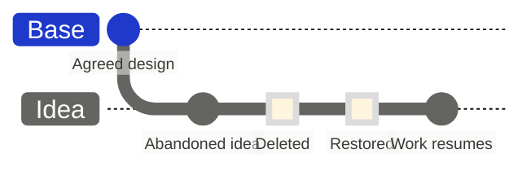

import { VisualPlaceholder } from "/snippets/visual-placeholder.jsx";

Each branch has an owner, an editing policy, and a lifecycle. What you can do to a branch depends on your role, whether you own it, and its editor groups.

<VisualPlaceholder kind="Screenshot" title="Recently deleted branches">
  The Recently deleted branches page with two deleted proposals, one row's Restore button selected and its restore plan shown.
</VisualPlaceholder>

## Organize branches

<VisualPlaceholder kind="Screenshot" title="Branch actions menu">
  A proposal branch's actions menu open: Reveal in Branch view, Rename..., Take ownership, the Editor groups submenu, Protect, and Delete branch.
</VisualPlaceholder>

- Choose **Reveal in Branch view** from a branch's actions menu to find it in the hierarchy.
- Choose **Rename...** to change its name. Its data and parent stay the same. Renames are not recorded, but a merge record keeps the name the branch had when it merged.
- Choose **Take ownership** to become the owner of a branch whose owner has left or lost access to the project. Admins can take ownership of any branch, or reassign it with **Assign owner...**. Ownership changes are recorded on the branch's review timeline.

## Control editing

Branch owners and Admins can set **Editor groups**, and the change is recorded on the review timeline. Membership in any selected group lets someone edit the branch; their role and other permissions still apply. Choose **Anyone (no restriction)** to remove the restriction. Being able to edit a branch does not let you merge into a parent you cannot edit.

Admins can protect a branch against direct edits, renames, and deletion. Base starts protected, so changes go through a branch and its review; workspaces that use the updated variant view leave Base unprotected. To allow direct edits again, choose **Unprotect branch** and confirm **Unprotect**. Admins can also choose **Require review to merge**.

## Delete and restore

Deleting closes a branch; it does not erase its changes.

1. Inspect the branch's changes. If it has sub-branches, delete or move those first; Flow blocks the deletion until you do. Base and protected branches cannot be deleted.
2. Choose **Delete branch**. The confirmation says whether the branch can be restored later or will be deleted permanently. Read it, then confirm.
3. To bring a branch back, open the branch actions menu, choose **Deleted branches**, and select **Restore** next to it under **Recently deleted branches**.
4. If the restore also needs deleted branches it was created from, or must update from a parent that has since changed, Flow shows the plan. Inspect every branch in it, then confirm the restore.

Deleting and restoring are recorded on the branch's review timeline. Merged branches are not listed for restore; their record is the merge entry in the parent's history. Deleted branches are kept for recovery, but long-term retention is not guaranteed. To keep a named reference to a state, create a [baseline](/branching/baselining).
