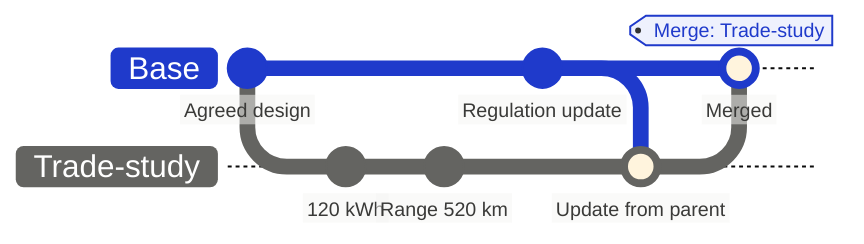
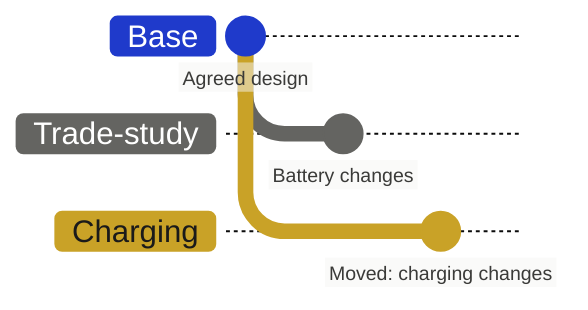

import { VisualPlaceholder } from "/snippets/visual-placeholder.jsx";

Merging is how a proposal becomes part of the agreed design. The parent takes the branch's changes, and Flow records the merge as its own entry in history, with who merged it, the reviews, and the discussion. Nothing on the branch is lost.

## Ask for review

1. On the branch's **Review** page, check **Changed Items**. It lists every difference from the parent.
2. When the work is ready, select **Ready for review**. The branch owner or an Admin can do this.
3. Add reviewers if the branch needs them. Required reviewers and reviewer groups can be added by an Admin, the branch owner, or an existing required reviewer. For a group, one member's approval counts for the group.

Reviewers open **Submit review** and choose **Approve** or **Request changes**, with a comment. Each reviewer has one current review; submitting again replaces it.

An edit made after approval dismisses the existing approvals, so reviewers see the final state. The dismissed approvals stay on the review timeline.

## Merge

The review panel shows **Ready to merge** or **Not ready**, with what is blocking: reviews, stage gates, checks, conflicts with the parent, or editor groups. When nothing blocks, select **Merge**.

<VisualPlaceholder kind="Screenshot" title="A branch ready to merge">
  Review side panel on the Battery capacity trade study: two approvals, Ready to merge, and the Merge button. Inset: the Not ready state listing one missing required review.
</VisualPlaceholder>

A merge writes the branch's net changes onto the parent. For each field, the parent records the final value from the branch and the person who last changed it there.

The merge also:

- Adds a `Merge: <branch>` entry to the parent's **Change history**, recording who merged it and when, the changed items, and the branch's reviews, description, and review timeline.
- Moves the branch's comments to the parent, labelled with the branch they came from, and carries over item subscriptions.
- Moves any open sub-branches onto the parent, so their work continues against the merged result.
- Closes the branch. It can no longer be edited, and links to it open the parent.
- Appears in the workspace [audit log](/administration/audit-log).

If the parent has moved on since the branch was last updated, [update from the parent](/branching/branching#update-from-the-parent) first and settle any conflicts.

Variants cannot merge into their parent. See [Variant branches](/branching/variant-branches).

### Merge automatically

If your organization's review policy allows automatic merging, choose **Merge When Ready**. Flow merges the branch as you once every requirement passes, re-checking each one at that point. It waits while the branch has open sub-branches. **Cancel Merge** stops it.

### Force a merge

When a merge is blocked and your organization's review policy lets you bypass it, Flow asks **Force bypass review and merge?** and requires a reason. The merge record keeps the reason and what was blocking at the time.

## Split a branch

If a branch has grown to hold two changes, move part of it into its own branch so each can be reviewed and merged separately.

1. On the **Review** page, select the items to move.
2. Choose **Create branch and move**. Flow creates a new branch beside this one, with the same parent, holding those items' changes.
3. Review each branch on its own.

The move is recorded on the review timeline. **Move changes back** undoes it.

## Undo a merge

A merge cannot be erased, but it can be reversed. In the parent's **Change history**, revert the `Merge: <branch>` entry. Flow creates a `Revert: Merge: <branch>` branch holding the opposite changes, which you review and merge. See [Baselining](/branching/baselining#revert-a-baseline).

[Tracing history](/branching/tracing-history) shows how to follow a merged value back to its branch.
