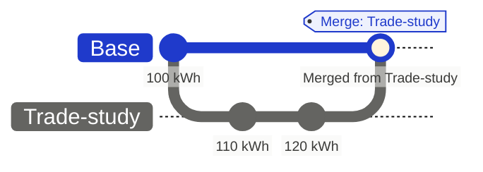
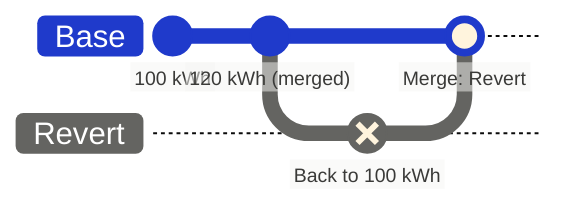

Flow keeps every change it records. Each edit is stored with the branch it was made on, the person or agent who made it, and when. Branch actions add to that record instead of rewriting it: a merge adds a merge record, a revert adds changes that undo earlier ones, and a deleted branch can be restored. [Branching](/core-concepts/branching#every-change-is-traceable) explains why.

That means you can answer four questions about any value: who set it, when, on which branch, and how it got to the branch you are looking at.

## Read an item's history

1. Open the item's details and select **History**.
2. Read the changes, newest first. Each shows who made it, or which agent, and when.
3. Changes are grouped by the branch they were made on. Changes that arrived through a merge sit under **Merged from** the branch that carried them, so you can see which proposal brought a value in.

In this example, the battery systems engineer raised **Battery Usable Capacity** in a trade study branch, in two steps, and the branch then merged into Base:

On Base, the item shows 120 kWh under **Merged from Trade-study**, attributed to the engineer who last changed it on the branch. The merge record names who merged it and holds the branch's reviews and discussion. Intermediate values from the branch, such as 110 kWh, are not repeated on the parent.

Each change has a menu:

| Action | What it does |
| --- | --- |
| **View this version** | Shows the item as it was at that change |
| **Compare from this version** | Opens a comparison from that change to now |
| **Revert this change only** | Undoes that one change |
| **Revert this item to this point** | Returns every field of the item to its state at that change |

A branch section header offers **Revert changes from this branch only**, which undoes what one branch or merge did to the item and keeps the rest.

## Undo without erasing

A revert never deletes the change it undoes. It adds new changes that set the old values back, and both stay in history.

When you choose a revert from the history menu, choose where the undo goes:

- **Revert and create a new branch** puts the undo in a branch so it can be reviewed and merged like any other change.
- **Revert in this branch** makes the undo directly, as your edit. It is not available on protected branches.

To undo everything a merge or milestone did, revert its baseline instead. See [Baselining](/branching/baselining#revert-a-baseline).

## Read a branch's timeline

Open **Change history** with the clock control to see a branch's baselines and merges in order. Select one to inspect it, or compare it with **Current**. **Parent update history**, in the same menu, lists each time the branch was updated from its parent and what came in.

## What each action records

| Action | What changes | What history keeps | How to undo |
| --- | --- | --- | --- |
| [Create a branch](/branching/branching#create-a-branch) | Nothing is copied; the branch starts from its parent's current state | Who created it, or which agent, and when | Delete the branch |
| Edit on a branch | Only that branch | Each change, with branch, person or agent, and time | Revert the change |
| [Update from parent](/branching/branching#update-from-the-parent) | Your branch takes in the parent's newer changes | Your branch's own changes keep their authors and times; the update is listed in **Parent update history** | **Create revert request** on that update |
| [Rebase onto](/branching/branching#move-work-to-another-parent) | A new branch under the target, holding a copy of your changes | The copies keep their original authors and times; the source branch is unchanged | Delete the copy |
| [Create branch and move](/branching/merging#split-a-branch) | Selected items move to a new sibling branch | Recorded on the review timeline | **Move changes back** |
| [Merge](/branching/merging#merge) | The parent takes the branch's net changes | A `Merge: <branch>` record with who merged, reviews, discussion, and changed items; the branch closes | Revert the merge baseline |
| [Create baseline](/branching/baselining) | Nothing | A named point in the branch's history | None needed |
| [Revert a baseline](/branching/baselining#revert-a-baseline) | A `Revert: <baseline>` branch with the opposite changes | The original changes and the revert, once merged | Delete the revert branch, or revert the revert |
| Revert an item | New changes that restore earlier values | The original changes and the revert | Revert again |
| [Delete a branch](/branching/managing-branches#delete-and-restore) | The branch closes and leaves the branch list | Its changes are kept | **Restore** |

## Limits

- On the parent, a merge does not record which agent made a change on the branch. Check the branch's review and its merge record.
- Renaming a branch is not recorded. A merge record keeps the branch's name as it was when it merged.
- Comparisons and history show only what your access allows. External recipients see the current state of what is shared with them, not its history.
