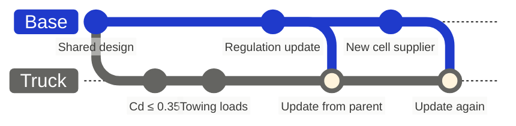
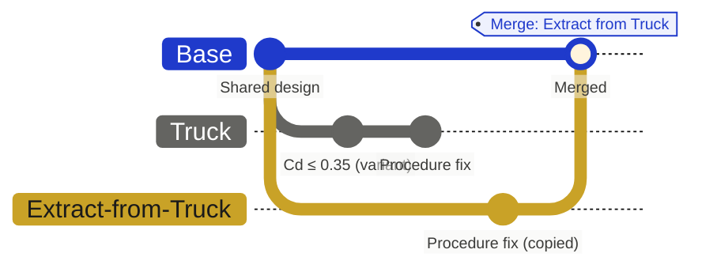

import { VisualPlaceholder } from "/snippets/visual-placeholder.jsx";

A variant holds a lasting difference from its parent, such as one model in a product family. It stays open and cannot merge into its parent. [Branching](/core-concepts/branching) explains how variants differ from proposals.

## Create a variant

1. [Create a branch](/branching/branching) under Base or under an existing variant.
2. Open its actions menu and choose **Promote to variant**.

A branch under an ordinary branch cannot become a variant; promote its parent first. **Demote from variant** turns a variant back into an ordinary branch without deleting its data. Demote its sub-variants first.

In workspaces that use the updated variant view, choose **New Variant**, or **Create a sub variant** on an existing variant. Work on a proposal in a change request beneath the variant.

## Mark what belongs to the variant

Some items exist only because of the variant. On a variant, select one or more items, open the item menu, and choose **Apply to variant** to mark them variant-specific. **Detach from variant** removes the mark.

<VisualPlaceholder kind="Screenshot" title="Apply to variant">
  On the Truck variant, a selected Towing Load item with its menu open on Apply to variant. Inset: the Extract non-variant changes target picker.
</VisualPlaceholder>

## Bring in parent changes

A variant never merges, so it takes in shared work by updating from its parent. Choose **Update from parent...**, or **Sync changes with parent...** in the updated variant view. Inspect the incoming changes, settle each conflict, and confirm. See [Working in a branch](/branching/branching#update-from-the-parent).

Proposals for a variant branch from the variant and merge back into it, like any other branch.

## Share changes beyond the variant

Work on a variant often produces changes every model needs. **Extract non-variant changes** copies them to a new branch so they can merge elsewhere.

1. On the variant's actions menu, choose **Extract non-variant changes**, then choose the target branch.
2. Flow creates `Extract from <variant>` under the target, holding every change except those to variant-specific items and the relationships that touch them.
3. Review the new branch before merging it. It follows the target's review and merge rules.

The extracted changes keep their original authors and times. The extracted items get new item numbers in the new branch.

For example, the Truck variant relaxes its drag coefficient target to 0.35 and adds its towing requirements, all marked variant-specific. The same work revises the Coastdown Procedure that every model uses. Extracting to Base carries the procedure change and leaves the Truck's target and towing requirements behind.

The variant stays open, and its own changes are untouched.
