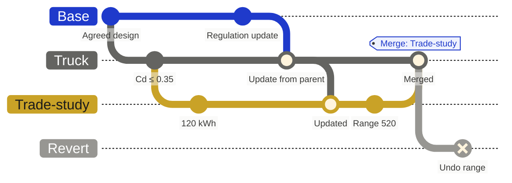
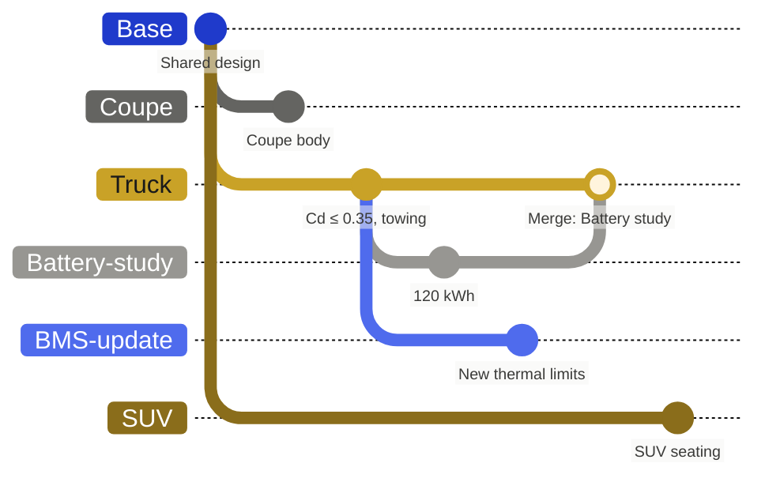

Hardware teams change their design while depending on it. A target gets revised mid-study. Three disciplines change related parts in the same week. One platform becomes three products.

Flow handles this with branches. A branch is a state of the project relative to a parent. Branches do two jobs: they manage variation in the design, and they let the team work on several changes at once. Underneath both is one principle: every change stays traceable.

## Every change is traceable

The most important idea in Flow is that history is never lost. Every edit is recorded with the branch it was made on, the person or agent who made it, and when. Branch actions add to that record instead of rewriting it:

- **Merging** writes a branch's changes onto its parent under a `Merge: <branch>` record that keeps who merged it, the reviews, and the discussion.
- **Updating from a parent** brings in newer work and lists the update in the branch's history, where it can be reverted.
- **Reverting** adds changes that undo earlier ones, usually in a branch of its own that is reviewed like any other. The changes it undoes stay in history.
- **Deleting** a branch closes it. Its changes are kept, and it can be restored.

So for any value, the team can answer: who set it, when, on which branch, and how it reached the branch they are looking at. The answer is evidence, not memory: a reviewer, an auditor, or an agent can follow the same trail. [Tracing history](/branching/tracing-history) shows where to look, and what each action records.

## Hold lasting variation

A product family shares a lot across its models: architecture, standards, regulations, common parts. That shared information lives in a base branch, and each model branches from it to hold only what is different. In an electric vehicle family, a **Truck** branch might relax the drag target and add towing loads, while a **Coupe** inherits the base values. A change in the base can flow to every model without being re-entered.

Coupe, Truck, and SUV are long-lived variants of the shared design. Battery-study and BMS-update are proposals on Truck: each starts from Truck, and each merges back into it when it is accepted.

These long-lived branches are **variants**. They are not meant to merge back. Some workspaces label them explicitly as variants.

## Develop changes in parallel

Several pieces of work are often underway at once: a trade study, a design update, a new feature. Each lives in its own branch from the state it changes.

These short-lived branches are **proposals**. Some workspaces call them change requests. Each one holds a coherent change: the revised items, their rationale, and the design and verification edits that go with them. The agreed state stays intact while the work happens, and nobody waits for anyone else to finish.

The point is not isolation for its own sake. It is speed. Parallel proposals let the team explore options and pick the best answer sooner.

## Make change inspectable

Software teams use version control to develop work independently and compare it with an established state. Flow applies the same principle to structured engineering information.

Anyone can open a proposal and compare it with its parent to see which items and values changed. [Impact analysis](/ai-automations/impact-analysis) goes further: it follows the graph from those changes to the items and owners they affect.

A comparison shows recorded differences. Engineering judgment decides whether they add up to an acceptable design change.

## Reconcile parallel work

The parent keeps moving while a proposal is open. Updating from the parent brings that newer work into the branch. Where the same information changed in incompatible ways, the team resolves the conflict deliberately rather than letting the last edit win.

Permissions and branch policies decide who can change a branch and who can incorporate its work.

## Name meaningful points in time

A [baseline](/branching/baselining) marks a state worth returning to, such as the design as presented at a milestone review. Branches and baselines answer different questions. A branch is where work happens. A baseline is a reference you compare against later.

When an accepted change has to be reversed, history matters. Flow reverses it as a reviewable change, so engineers can see what returns and what has happened since, and the original change stays on the record.

## Keep the context visible

The same item can have a different value in another branch. Before editing, importing, or asking the agent to make changes, check which branch you are in.

Branches govern changes inside Flow. An action taken in a connected external tool takes effect in that tool, and switching branches in Flow does not undo it.

To run your first proposal, follow [Creating a branch](/get-started/creating-a-branch). [Branching](/branching/branching) covers the day-to-day tasks.
