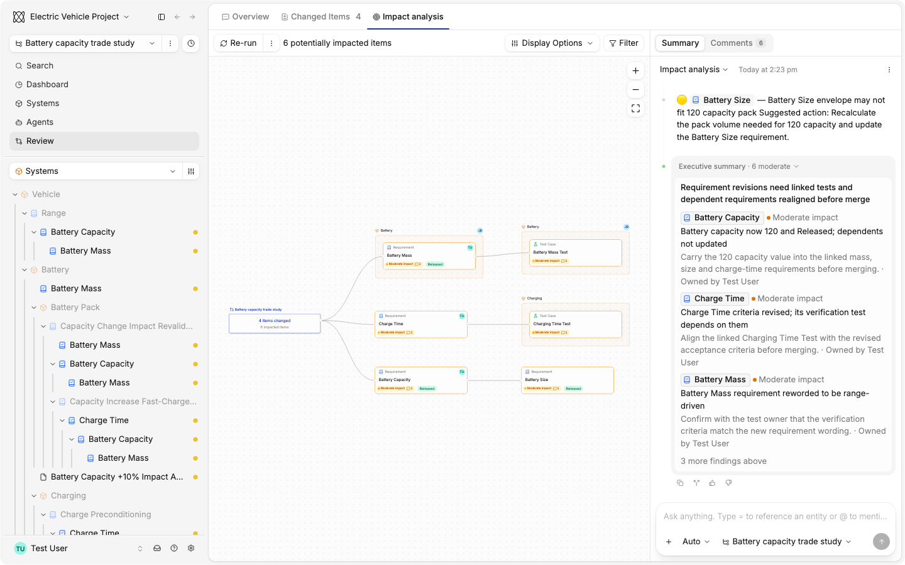
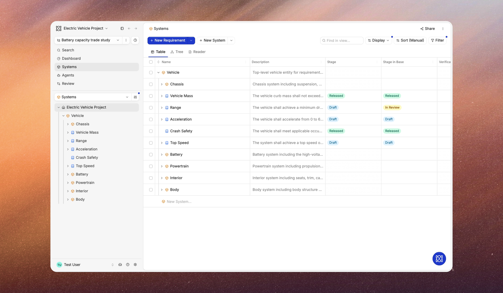

import { Scene } from "/snippets/scene.jsx";
import { scene as newBranchDialog } from "/snippets/scenes/new-branch-dialog.jsx";

A branch is where you develop a change without disturbing the agreed design. Other engineers keep working, and several proposals can move forward at once. Every change you make in it is recorded, so its history stays [traceable](/branching/tracing-history) after it merges.

You need permission to create branches in the project.

## Create the branch

Open the branch selector and choose **New branch**.

<Scene scene={newBranchDialog} alt="The New branch dialog with Battery capacity trade study as the name and Base as the parent branch. Select the parent branch to open the branch picker." />

1. Enter a **Name** that says what the work is, such as *Battery capacity trade study*. `main` and `master` are reserved.
2. Check **Parent Branch**: the state your branch starts from. For a proposal against an agreed design, choose that design's branch; for work that depends on another proposal, choose that proposal's branch. Different entry points can preselect different parents.
3. Choose **Create**.

## Make the change and see its impact

1. Confirm the sidebar shows your new branch.
2. Make the change, and record the rationale in the description of the item you changed.
3. Update what depends on it and what the proposal needs. Leave historical results as they are; a new target does not change what an earlier test measured.
4. Open **Review** for your branch. **Changed Items** lists every recorded difference from the parent.
5. Open the **Impact analysis** tab and choose **Run impact analysis**. Flow follows the connections from what you changed, summarizes which items and systems are affected, and shows who owns them. Running it requires AI to be enabled for your workspace.

Use the result to decide who to talk to. For example, raising the bike's Battery Usable Capacity from 720 Wh to 840 Wh improves range but adds mass and lengthens charge time, so the proposal needs the product lead engineer, who owns the bike's range and mass, as well as the battery systems engineer. If you ask the agent to help, name the branch and the task, and ask it to inspect before it edits.

To see your values beside the parent's while you work, add a column to a Table view: open **Display options → Choose columns...**, choose **Add field → Field in another branch…**, then pick the branch and the field. The new column is read-only, and an item the other branch does not hold reads **Not in** followed by the branch name.

## Keep the proposal current

Keep one proposal's work together: the changed items, their rationale, and the design and verification changes they need. If the parent changes while you work, use **Update from parent** to bring that work into your branch, and resolve any conflicts deliberately.

[Branching](/core-concepts/branching) explains why Flow manages change this way.
