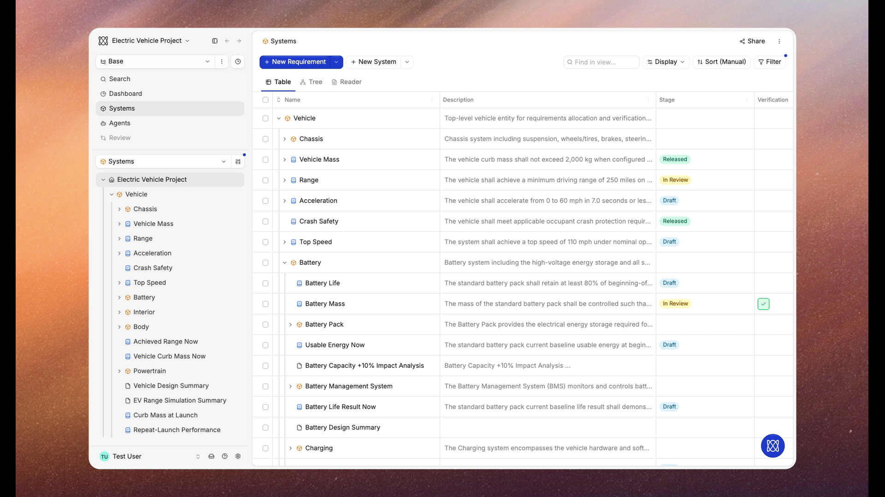

import { Illustration } from "/snippets/illustration.jsx";

## What Flow is

Flow is a source of truth that lets humans and agents deeply understand your physical system. It pulls and manages context from the places your team already works, so it is clear what you intend to build and how close you are to achieving it. On that foundation, you can spin up agents that work in the background to close the gap and increase your engineering velocity.

In Flow, your team keeps the product breakdown, requirements, interfaces, analyses, and tests as connected items, each with an owner. Changes are developed in branches and reviewed before they merge. Agents read and work on the same items your engineers do.

## Watch the overview

<Frame>
  <iframe
    src="https://www.loom.com/embed/28ae4215644c41068e366834ad5444db"
    title="Flow overview"
    style={{ width: "100%", aspectRatio: "16 / 9", border: 0 }}
    allowFullScreen
  />
</Frame>

## The problems Flow solves

Hardware teams lose time in three places. Flow is built to remove each one.

### No single source of truth slows decisions

Engineering information is spread across spreadsheets, documents, models, code, tickets, and chat. Before anyone can decide, someone has to find the latest version and check it against everything else. Decisions wait on that search.

Flow holds every structure a hardware program runs on in one connected model: the product breakdown, interfaces, requirements, analyses, tests, parts, suppliers, risks, and decisions. Your team defines the categories of items and the fields they carry. Import files, extract records from documents with the agent, and connect the tools your team already uses. Each item has an owner, the engineer closest to that part of the design, who keeps it current.

Because the items are connected, the answer to a question is a few links away. Follow a design decision to the systems it affects, an interface to the teams on either side of it, or a target to the analyses and tests that back it. With intent and evidence in the same model, the gap between them is visible:

<Illustration name="what-is-flow-intent-evidence" width={640} alt="Flow connects each target to the evidence for it: one target is met, one is close but not there, and one has no evidence yet." />

Here, one target is met, one is close but not there yet, and one has no evidence at all. Views show the same items for different jobs: a table to compare and edit, a tree for structure, **Reader** to read and comment like a document, and a diagram to see how parts connect.

[The systems graph](/core-concepts/the-systems-graph), [the data model](/core-concepts/the-data-model), and [Getting data into Flow](/get-started/getting-data-into-flow) go further.

### Changes made one at a time slow iteration

When there is one copy of the design, changes queue up behind each other. A trade study waits until the last update is finished, and an idea is hard to try without disturbing the agreed state.

Branches let the design change in parallel. Each proposal gets its own working state, so several engineers can develop changes at once while the agreed design stays as it is. Compare a proposal with its parent at any time, take in newer work from the parent as it lands, and merge when the proposal is reviewed. Branches also hold lasting variants built from a shared base. Every change is recorded, so the history behind any item can be [traced](/branching/tracing-history).

[Branching](/core-concepts/branching) explains both jobs.

### Problems found at review cause rework

A change to one part of the design reaches others. Raise the battery's usable capacity and vehicle mass, range, and charge time all move with it. When those effects only surface at a design review, work built on the old assumptions has to be redone.

Flow shows what a change affects while it is still a proposal. [Impact analysis](/ai-automations/impact-analysis) follows a branch's changes through the connected items and flags the ones that may need to change too, for their owners to check before anything merges. Agents read the same source of truth your engineers do: chat with the agent to answer a question or make a change, save how your team does a task as a [skill](/ai-automations/skills), and set up [automations](/ai-automations/automations) that work in the background, such as reviewing a pull request against the requirements it touches.

[How Flow uses AI](/core-concepts/ai-automations) walks through an example.

## Start here

1. [Start a project](/get-started/starting-a-project).
2. [Bring in your existing information](/get-started/getting-data-into-flow).
3. [Create a branch](/get-started/creating-a-branch) for your first proposal.
