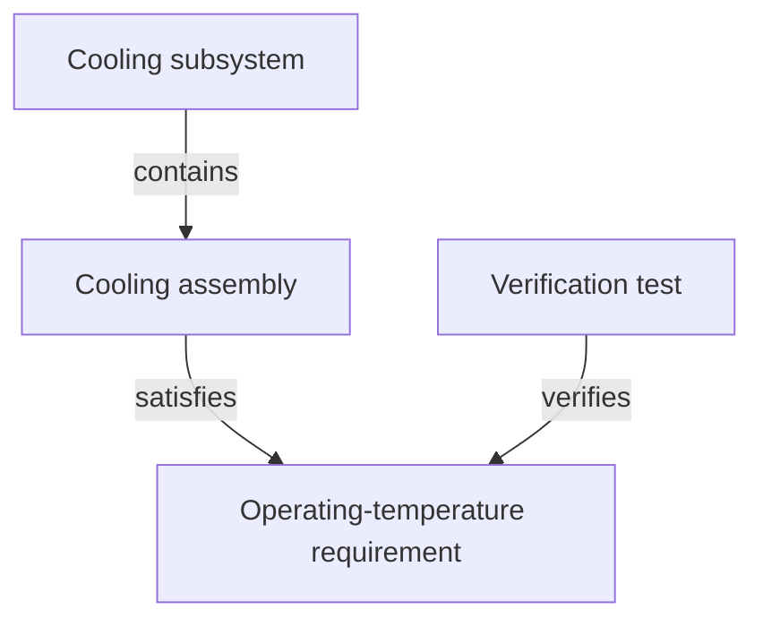

A Flow project brings engineering information and its change history together. The concepts below explain how that information is organized and how a team works on it.

## Workspaces and projects

A **workspace** is the shared organizational space where members access Flow. A **project** holds the model for an engineering effort, along with its views, branches, and history. Access determines which projects and information a person can use.

For example, a team might work in a vehicle project that includes a cooling subsystem. The exact project boundaries depend on how the organization structures its work.

## Items, categories, and fields

An **item** represents something the team needs to describe or track: a requirement, system, component, interface, or test case.

A **category** defines a type of item. **Fields** describe its properties, such as a requirement's text, a component's mass, or an item's owner. The project's **data model** defines its categories, fields, and permitted relationships. Teams configure that model to suit their engineering work.

In the cooling example, the operating-temperature requirement, cooling assembly, and verification test are separate items. Each holds the information relevant to its role. Documents and attachments can provide explanations and evidence.

## Hierarchy and relationships

Hierarchy describes how items are organized into larger structures. A cooling assembly can sit within a cooling subsystem, which is part of a larger system.

Other relationships connect items across that structure. An assembly can address a requirement, and a test can verify it. These connections let engineers follow engineering meaning as well as location.

This fictional example illustrates the relationships; category and relationship names depend on the project's data model. The test's evidence supports the team's assessment of whether the requirement has been met.

## Views

A **view** selects and presents information from the model. Tables support comparing fields, trees show structure, Reader presents document-oriented content, and diagrams show items and connections.

The same item can appear in several views without becoming a separate copy. Within the same project and branch, editing an item's value changes the underlying item; another view can display that updated value. Filters narrow what is shown, while permissions determine what a person can access.

## Branches and change requests

A **branch** is a separate version of the project where work can develop independently of its parent. **Base** is the project's main branch. Creating another branch allows a team to prepare a proposal before applying it to the parent.

A **change request** brings a proposal into review. Reviewers can inspect added, updated, and removed items, discuss the changes, and record their decisions. A branch is where the work develops; a change request is how the team presents and reviews that work.

For the cooling subsystem, the proposal might revise the temperature requirement, update the assembly, and adjust the verification test together.

## Reviews, merges, and baselines

A **review** examines a proposal and its supporting context. Owners and reviewers assess the work, discuss questions, and resolve disagreements. The project's review rules determine when it is ready to merge.

A **merge** applies accepted changes to the parent branch. If parallel work conflicts, the team resolves those differences as part of preparing the merge.

A **baseline** records a project state at a point in time, such as an agreed milestone. Teams can compare states and inspect history to understand what changed. A baseline can also be created independently of a merge.

## Variants

A **variant** maintains an alternative design over time. It is useful when the team needs to retain and develop more than one solution, such as two cooling-system designs.

A change request proposes work to merge into its parent. A variant preserves an alternative; selected work can later be proposed for its parent. This distinction keeps exploration separate from the decision to adopt a change.

## AI agents and automations

An **AI agent** can help explore project information, answer questions, and prepare authorized changes. An **automation** applies instructions to recurring or triggered work. Both rely on the available project context and permissions.

Their results still need the same engineering assessment as manually authored work. The model, views, and reviews provide the context for that assessment.

For the purpose behind these concepts, read [Why Flow?](/overview/why-flow). For programmatic access to project data, continue to the [API introduction](/api).
